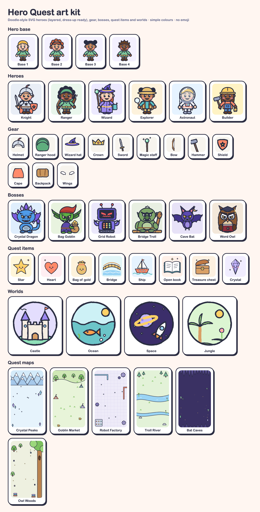

# Hero Quest art style

Every picture and icon in the app is a **doodle-style SVG**: a thick, slightly wobbly navy outline around flat, soft
colours. **We never use emoji** for heroes, bosses, quest art or buttons. The whole kit is drawn in code by
`scripts/make-art.mjs` (`npm run art`). It writes one SVG per piece to `public/art/` and a contact sheet to
`docs/art-kit.html` (screenshot: `docs/art-kit.png`). Change the script and run it again; never hand-edit the SVGs.

## The look

- **Outline:** ink `#2b2d42`, 5px on a 200×200 canvas (3–4px for small details), round caps and joins.
- **Hand-drawn wobble:** the `#doodle` filter (`feTurbulence` + `feDisplacementMap`, scale ≈3) on the whole drawing.
  In CSS the same idea is the uneven corner radius `--rd` / `--rd-s`.
- **Fills:** flat, from the palette below. No gradients, no textures, no drop shadows inside the art.
- **Simple shapes:** circles, ellipses, rounded paths. If a 5-year-old couldn't draw it with a crayon, simplify it.
- **Extras:** small four-point sparkles (`sparkle()`) for magic or shine, at most two or three per picture.

## Palette

| Token | Hex | Use |
|---|---|---|
| ink | `#2b2d42` | every outline, text |
| coral | `#ff8a6b` | capes, hearts, accents (CSS `--coral`) |
| butter | `#ffd166` | gold, stars, coins, main buttons (`--butter`, `--gold`) |
| teal | `#6cc5c9` | English lane, water (`--teal`) |
| mint | `#8fe0b9` | magic, grass, success glows (`--mint`) |
| lavender | `#c3b4ff` / `#9d8af0` | wizard things, crystals (`--lav`) |
| sky | `#9ad4f5` | sky, glass, robots (`--sky`) |
| khaki / brown | `#e8c071` / `#d9a066` | wood, bags, hats (`--brown`) |
| cream | `#fff3dc` | bellies, faces of items |

UI tokens live at the top of `src/styles/app.css`. A strong text or white-on-colour version of coral is `--c: #e0583d`.

## Heroes: kids in gear, built to dress up

Heroes are **children**, not animals. Each one is the same body (the "rig") wearing different things, so later quests can
unlock new outfits, headgear and gear.

- **Layers, back to front:** back item (cape, backpack, quiver, jetpack, wings) → back of headgear (hood) → long hair →
  legs and boots → torso (outfit) → arms (sleeves) → main-hand item → hands → off-hand item (shield, book, lantern) →
  ears and head → face → front hair → headgear.
- **Fixed anchor points** (200×200): head centre (100, 74) r40, main hand (50, 152), off hand (150, 150), shoulders
  (74, 122) and (126, 122), boots at y 187. Any new gear must fit these points so it works on every hero.
- **Variety without labels:** four skin tones (`light`, `tan`, `brown`, `deep`), four hair colours, five hair styles
  (`short`, `long`, `buns`, `curly`, `spiky`). Mix them across the presets. No hero is "for boys" or "for girls", and
  outfits and colours are not gender-coded.
- **Faces:** dark oval eyes with a white shine, small determined brows, pink cheeks, an open smile.
- **Gear is gentle:** wooden or rounded swords, staffs, bows with no arrows aimed at anyone, hammers, shields. Nothing
  sharp-looking pointed at the viewer. No blood, no injuries, ever.
- The six starter heroes are `hero-knight`, `hero-ranger`, `hero-wizard`, `hero-explorer`, `hero-astronaut` and
  `hero-builder` (`src/heroes.ts`). Old saves with animal heroes are renamed in `migrate()` (`src/learn/learner.ts`).
- In the app: `<HeroAvatar :avatar full/>` shows the whole hero; without `full` it is a head-and-shoulders badge.

## Bosses: cheeky and a bit fierce, not cute

The child has to feel the boss is worth beating, but a 5-year-old must never be scared.

- **Do:** angry slanted brows, heavy-lidded eyes (`lidEye()`), yellowish or glowing eyes, toothy grins, fangs, tusks,
  spikes, claws, stronger and darker colours than the heroes.
- **Don't:** blush cheeks or soft round "aww" eyes (those are for heroes and items), blood, injuries, realistic teeth or
  horror faces.
- Each boss carries a hint of its quest: the Grid Robot has a 3×3 grid of dots, the Bag Goblin holds a bag of gold, the
  Bridge Troll stands on a bridge.
- Files are `boss-<name>.svg`; `data/quests.json` names them in `boss.art`.

## Quest items, worlds and icons

- **Quest items** (`star`, `heart`, `gold-bag`, `bridge`, `ship`, `book`, `chest`, `crystal`) may have tiny happy faces.
  `data/quests.json` names one in `art` for each quest card.
- **Worlds** are round badges (`world-castle`, `world-ocean`, `world-space`, `world-jungle`).
- **UI icons** (speaker, star, heart, pencil, printer, map, gear, …) are in `src/components/Icon.vue`: the same ink
  outline and palette on a 48×48 grid. Use `<Icon name="…"/>` and never put emoji in buttons, labels or spoken prompts.

## Quest maps

Each quest has its own map: a scene that belongs to its boss and a road with its own twists.

| Quest | Scene | Road |
|---|---|---|
| Jump through 10 | Crystal Peaks: snowy mountains, crystals | ice |
| Equal groups | Goblin Market: tents, coins, trees | dirt |
| Arrays | Robot Factory: grid floor, cogs, pipes | metal |
| Blend bridge | Troll River: two rivers to cross, reeds | wood |
| sh ch th | Bat Caves: stalactites, glowing mushrooms | stone |
| Heart words | Owl Woods: a big tree, books, letters | leaves |

- The scene is `public/art/map-<scene>.svg` (portrait) and `map-<scene>-wide.svg` (laptops, landscape), drawn by
  `SCENES` in `scripts/make-art.mjs`. Scenery hugs the edges and stays soft; the middle is open for the road.
- Where the stones sit is data: `map.path` in `data/quests.json`, six `[x%, y%]` points on a portrait map, Learn it
  first and the boss last. Make each quest's path its own shape; keep neighbouring stones at least ~25% apart.
- The app draws the road through the stones with a bend between each pair (the same bends every visit), in the
  scene's road colours (`.qpath[data-scene=…]` in `app.css`). Wide screens turn the path on its side.
- Only the next stone and the boss carry a label, and the hero stands on the stone they're up to.

## Adding art

1. Draw it in `scripts/make-art.mjs` with the shared helpers (`eye`, `cheek`, `smile`, `tube`, `sparkle`, `star`,
   `both`, `lidEye`). New hero gear goes in `HEADS`, `MAIN`, `OFF`, `BACK` or `OUTFITS` at the rig's anchor points.
2. `npm run art`, then open `docs/art-kit.html` and check it sits well next to the rest.
3. Check it at phone size in the app: small art must still read at 48px.
4. Update `docs/art-kit.png` when the kit changes (screenshot the contact sheet).

The pictures inside activities (word pictures in `src/shared.ts`, such as the frog in "Build the word") are still emoji
and are next in line to be redrawn in this style.
